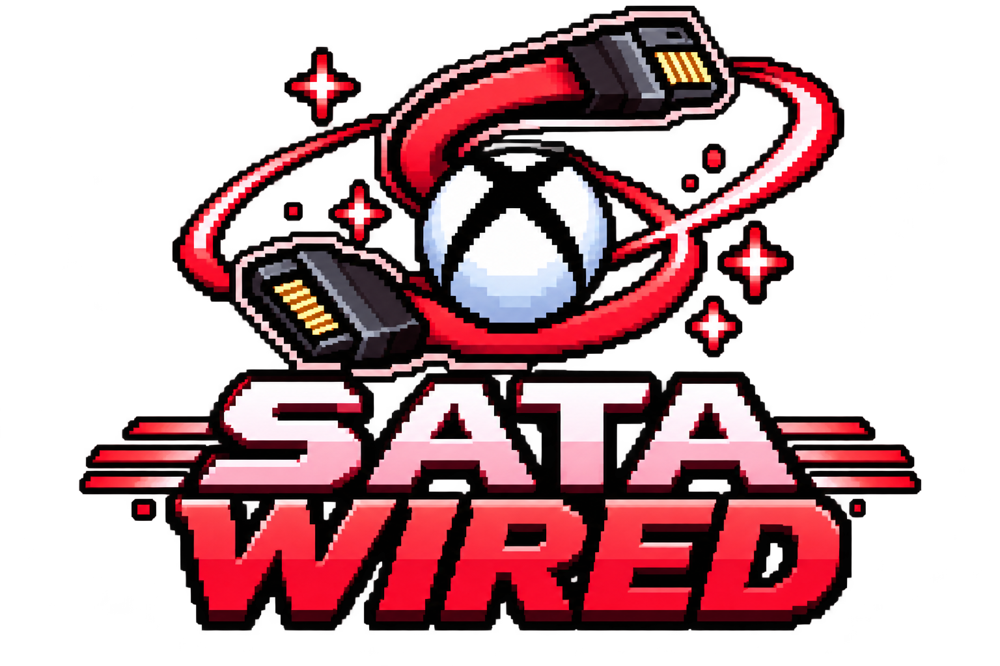

<h1>Satawired</h1>

<b>Xbox One and Xbox Series X|S software on Windows, by translation.</b>

<a href="#compatibility">Compatibility</a> ·
<a href="#status">Status</a> ·
<a href="#how-it-works">How it works</a> ·
<a href="#building">Building</a> ·
<a href="#usage">Usage</a> ·
<a href="#roadmap">Roadmap</a>

---

## Satawired

Satawired is an experimental Xbox-to-Windows compatibility project focused on
bringing Xbox One and Xbox Series X|S software to PC through emulation,
system-level translation, and compatibility implementations.

The long-term goal is to recreate the Xbox software environment sufficiently
to allow Xbox-native applications and games to operate on Windows PCs without
requiring Xbox hardware.

## Compatibility

Compatibility is under active development. Xbox software compatibility is not
currently guaranteed. The project aims to progressively implement the
functionality required by Xbox software, from basic runtime services to
graphics, system APIs, and hardware interaction.

## Status

Satawired is in early development. Its current components are experimental
and serve as the foundation for a future Xbox compatibility runtime.

## How it works

Satawired aims to bridge Xbox software and Windows through a custom
compatibility and translation layer.

Instead of expecting Xbox software to work natively on Windows, Satawired
will recreate or translate the Xbox environment and map supported
functionality to Windows and PC hardware.

The planned architecture consists of:

- **Executable analysis** — identifying executable structures, dependencies,
  imports, and platform requirements.
- **Runtime environment** — implementing the system functionality Xbox software
  expects.
- **System translation** — mapping Xbox-specific APIs and services to
  Windows-compatible implementations.
- **Graphics translation** — translating supported Xbox graphics operations
  into a PC graphics backend, with Vulkan as a target.
- **Hardware integration** — connecting translated functionality to PC CPU,
  GPU, memory, storage, audio, and input systems.

The goal is to build a real compatibility runtime that evolves beyond
executable inspection and progressively supports actual Xbox software execution.

## Building

Build instructions will be added as development progresses.

## Usage

Usage instructions will be added as features become available.

## Roadmap

- [ ] Core compatibility runtime
- [ ] Xbox executable analysis
- [ ] CPU and runtime compatibility
- [ ] System API translation
- [ ] Memory and system services
- [ ] Graphics translation and Vulkan backend
- [ ] Audio support
- [ ] Input support
- [ ] Windows hardware integration
- [ ] Compatibility testing
- [ ] Xbox software execution support
